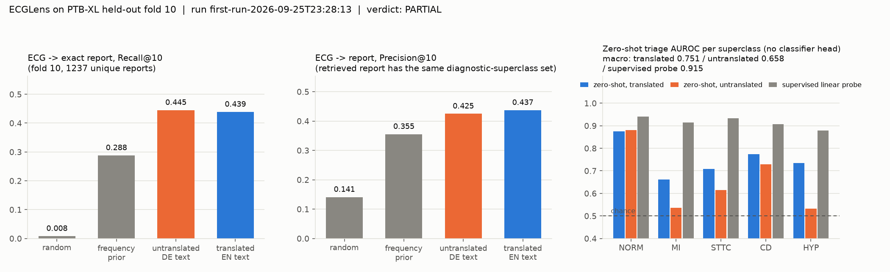
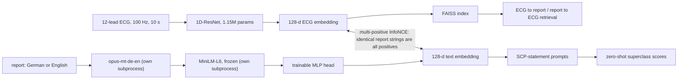

# ECGLens - cross-lingual ECG <-> report retrieval on PTB-XL (PARTIAL: retrieval works, "translation is load-bearing" does not clear its bar)

> **Research retrieval demo. NOT a diagnostic device.** Never use it for clinical decisions.

A small (1.15 M-param) 1D-ResNet ECG encoder is aligned, with a multi-positive contrastive loss, to sentence embeddings of the
paired clinical reports in PTB-XL (63% German / 35% English by our marker heuristic; German is machine-translated with
`opus-mt-de-en`). It supports ECG -> similar reports, report text -> similar ECGs, and zero-shot triage over the 5 diagnostic
superclasses using text prompts built from the SCP-ECG statement table (no classifier head).

**EVAL GATE verdict: PARTIAL** (first run, held-out fold 10, single seed - full write-up in [EVAL-FINDINGS.md](EVAL-FINDINGS.md)):

| Claim (thresholds fixed before training) | Result | Verdict |
|---|---|---|
| C1 retrieval: strict ECG -> exact-report R@10 >= 5x random and beats a training-frequency prior by >= 0.05 (also on same-superclass-set P@10) | **R@10 = 0.439** vs 0.008 random (54x) vs 0.288 prior; P@10 0.437 vs 0.355 prior | pass |
| C2 zero-shot: macro-AUROC >= 0.75 with SCP-statement prompts | **0.7509** (margin 0.0009; the alternative short-name prompts give 0.733) vs 0.915 for a supervised linear probe on the same encoder | pass, barely |
| C3 translation is load-bearing: same-set P@10 gain >= 0.02 with CI > 0 | **+0.012** (95% CI 0.005 to 0.020); strict R@10 delta -0.006 (CI spans 0) | **fail** (real but below the bar) |



*Generated by `scripts/06_make_figure.py` from `eval_results.json` (run 0 = the first, ground-truth run).*

## Findings you should know before trusting any number

* **Recording-site confound is real.** The ECG embedding alone predicts *report language* with AUROC 0.86 (`diagnostics.json`), and top-10 hits
  are in the query's own language 73% of the time vs a 53% base rate. With the gallery restricted to the query's own language the model still beats the
  prior (strict R@10 0.508 vs 0.313; same-set P@10 0.435 vs 0.334), so the signal is not *only* style - but part of the headline number is site/device style.
* **Label leakage is quantified, not ignored.** A text-only probe on report embeddings gets macro-AUROC 0.927 on the superclasses; the report string predicts
  its ECG's own superclass set 79.7% of the time (for the 55.6% of test reports also seen in training). 3.6% of rows still contain a cardiologist `Edit: NORM 100, ...`
  annotation or a truncated machine marker; excluding those test queries moves strict R@10 from 0.439 to 0.433.
* **Zero-shot is prompt-fragile, and translation only helps for one prompt set.** With statement prompts, translated 0.751 vs untranslated 0.658; with the
  short superclass-name prompts the ordering flips (0.733 vs 0.740). MarianMT garbles some clinical shorthand ("Vorhofflimmern" became "pre-throat fibrillation").
* Untranslated German through the English MiniLM is as good as translated at *exact-report identification* (0.445 vs 0.439): identifying a string needs a distinguishable embedding, not correct semantics.
* Single training seed per arm; CIs are bootstrap over test queries only (no seed variance).

## 30-second demo (no PTB-XL download, no API key)

```bash
pip install -r requirements.txt
python demo.py                                   # 3 held-out ECGs: top-5 retrieved reports + zero-shot scores vs true labels (~3 s)
python demo.py --query "atrial fibrillation with left bundle branch block"   # report -> most similar ECGs (downloads MiniLM ~90 MB once)
python scripts/06_make_figure.py 0               # regenerate docs/results.png from eval_results.json
```

`demo/` holds a 5 MB trained checkpoint and 300 held-out ECGs (`demo/pack.npz`, PTB-XL fold 10, CC-BY 4.0).

## Architecture



## Reproduce from scratch

```bash
# PTB-XL mirror (1.8 GB; PhysioNet itself is throttled): huggingface.co/datasets/longisland3/ptb-xl -> data/raw/
python scripts/01_prepare_text.py
python -m ecglens.text_worker translate data/de_unique.json data/translations_de_en.json   # cached copy is committed
python scripts/02_load_signals.py && python scripts/03_embed_text.py
python scripts/04_train.py untranslated 20 && python scripts/04_train.py translated 20      # ~2 min/epoch on 12 CPU cores; one at a time (memory)
python scripts/05_eval.py                        # APPENDS to eval_results.json; never overwrites
python scripts/08_diagnostics.py && python scripts/09_leak_subset.py && python scripts/07_make_demo_pack.py
```

## Data notes (where reality differed from the docs)

* The HF mirror's `ptbxl_database.csv` is valid UTF-8 in which lowercase umlauts are stored as capitals; reading it as `latin-1` is wrong here. We decode UTF-8 and lowercase.
* Language is not a column; we flag it with a marker heuristic (63% de / 35% en / 2.7% sv). The 584 Swedish-flagged records (Marian de->en does not translate Swedish) are excluded everywhere; 21,215 records are used.
* Split: PTB-XL `strat_fold` 1-8 train, 9 checkpoint selection, 10 test (never touched during training).
* Retrieval gallery = the 1,237 unique cleaned report strings of fold 10, so each query has exactly one strict-relevant item (no ties). Because reports are heavily templated, strict retrieval is paired with a same-superclass-set metric and a frequency-prior baseline.
* Each model (Marian, MiniLM) runs in its own subprocess; loading both in one interpreter has crashed this sandbox before.

## Reference

* **Based on:** MERL - *Zero-Shot ECG Classification with Multimodal Learning and Test-time Clinical Knowledge Enhancement*, Che Liu, Zhongwei Wan, Cheng Ouyang, Anand Shah, Wenjia Bai, Rossella Arcucci, ICML 2024, arXiv:2403.06659. Related work surfaced during idea validation and **not** read line by line for this build: ECG-report retrieval for clinicians (arXiv:2304.06286) and a 2026 PTB-XL German-reports + multilingual-embedding paper (arXiv:2602.19367). *(IDs come from memory and the validation notes; verify before citing.)*
* **Dataset:** PTB-XL - Wagner et al., *PTB-XL, a large publicly available electrocardiography dataset*, Scientific Data 2020, doi:10.1038/s41597-020-0495-6 (CC-BY 4.0).
* **What was reproduced / where this diverges:** the idea of ECG-text contrastive alignment with zero-shot superclass prompts. This is a small, CPU-trained, PTB-XL-only reproduction (MERL pretrains at scale on MIMIC-ECG with a different text encoder and prompt enhancement) and makes **no SOTA or novelty claim**. Additions: a translation ablation, a multi-positive loss for templated reports, a tie-free unique-report gallery, a frequency-prior baseline, and the site/language-confound and label-leakage diagnostics above. The delta worth reporting is nuanced/negative: translation is not load-bearing for exact retrieval, and ECG-only embeddings carry a strong site (language) fingerprint.

## Limits

Research demo; not clinically validated; single seed; PTB-XL only; MarianMT garbles some clinical shorthand; demo report -> ECG search covers only 300 ECGs.
